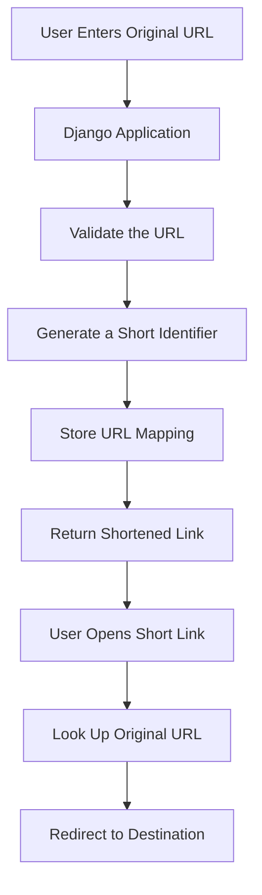

<div align="center">

# URL Shortener

### Transform Long URLs into Short, Shareable Links

A Python and Django web application project focused on URL shortening, link management, and redirect handling.

<p>
  
  
  
  
</p>

**Simple URLs. Easy Sharing. Python-Powered Development.**

[Explore Repository](https://github.com/maahii-in/url_shortner_python) · [Report an Issue](https://github.com/maahii-in/url_shortner_python/issues)

</div>

---

## Overview

**URL Shortener** is a Python-based web application project built with Django. It focuses on the core concept of converting lengthy URLs into shorter links that are easier to share and use.

URL shortening services generally work by associating a short identifier with an original URL. When someone opens the shortened link, the application looks up the destination and redirects the browser to the original address.

This project provides a foundation for exploring web application development, Django request handling, database integration, URL routing, and deployment using a Python application server.

## Key Features

- **URL Shortening** — The core objective is to create compact links from longer URLs.
- **Link Redirection** — Resolve a short identifier to its associated destination.
- **Django Framework** — Use Django's web application framework and request-handling capabilities.
- **Database Integration** — The repository includes an SQLite database file.
- **Deployment Configuration** — Includes a `Procfile` configured to start the application with Gunicorn.
- **Python Dependency Management** — Includes a `requirements.txt` file for installing project dependencies.
- **Production-Server Integration** — Includes Gunicorn and WhiteNoise dependencies.

*The exact available features depend on the application source code. Authentication, analytics, custom aliases, link expiration, and other advanced capabilities should not be assumed unless implemented.*

## How It Works

A typical URL-shortening workflow follows these steps:



### Workflow Explanation

1. The user submits a long URL through the application's interface.
2. The application validates the submitted address.
3. A short identifier is generated for the destination URL.
4. The original URL and its short identifier are stored in the configured database.
5. The application returns the shortened link.
6. When the shortened link is opened, the application retrieves the destination and redirects the browser.

*This is the intended URL-shortening workflow, not a verified description of every implementation detail in the current source code.*

## Technology Stack

| Technology | Purpose |
|---|---|
| Python | Core programming language |
| Django | Web application framework |
| SQLite | Database file included in the repository |
| Gunicorn | Python WSGI application server |
| WhiteNoise | Static-file serving support |
| Hashids | Identifier-generation utility available in the dependencies |
| ShortUUID | Compact, URL-friendly identifier utility available in the dependencies |
| Git and GitHub | Version control and source-code hosting |

The repository also includes several supporting packages. Refer to `requirements.txt` for the complete dependency list.

## Project Structure

The currently visible repository contains these root-level files:

```text
url_shortner_python/
│
├── Procfile
├── README.md
├── db.sqlite3
├── manage.py
├── requirements.txt
└── runtime.txt
```

### Important Files

| File | Purpose |
|---|---|
| `manage.py` | Django command-line utility for administrative tasks |
| `requirements.txt` | Python dependencies and pinned package versions |
| `runtime.txt` | Specifies the Python runtime version |
| `Procfile` | Defines the Gunicorn application startup command |
| `db.sqlite3` | SQLite database file |
| `README.md` | Project documentation |

### Required Django Source Package

The current `manage.py` and `Procfile` reference a Django project package named `urlshortner`.

The expected project structure should also include the appropriate Django configuration and application modules, for example:

```text
url_shortner_python/
│
├── urlshortner/
│   ├── __init__.py
│   ├── settings.py
│   ├── urls.py
│   ├── wsgi.py
│   └── asgi.py
│
├── <application_modules>/
├── manage.py
├── requirements.txt
├── runtime.txt
├── Procfile
└── README.md
```

The application module name above is a placeholder, not the name of a verified directory.

**Important:** Restore the actual Django source files before running the setup commands. They are not present in the repository's currently visible file listing, and the application cannot start correctly without the referenced configuration module.

## Getting Started

Follow these steps to prepare a local development environment after restoring the required source files.

### Prerequisites

- Python 3.9.x
- Git
- pip
- A terminal or command-line interface

The repository specifies Python 3.9.1 and pins older package versions. Use a compatible environment and review dependency compatibility before upgrading packages.

### Step 1: Clone the Repository

```bash
git clone https://github.com/maahii-in/url_shortner_python.git
```

### Step 2: Navigate to the Project

```bash
cd url_shortner_python
```

### Step 3: Create a Virtual Environment

**Linux / macOS**

```bash
python3.9 -m venv .venv
source .venv/bin/activate
```

**Windows PowerShell**

```powershell
py -3.9 -m venv .venv
.venv\Scripts\Activate.ps1
```

### Step 4: Install Dependencies

Upgrade pip:

```bash
python -m pip install --upgrade pip
```

Install the project dependencies:

```bash
python -m pip install -r requirements.txt
```

Because the dependency file contains older packages, installation may require adjustments depending on your operating system and Python environment. Test compatibility before changing pinned versions.

### Step 5: Apply Database Migrations

After confirming that the Django configuration and application modules are available, run:

```bash
python manage.py migrate
```

To create an administrator account for Django's admin interface, when configured:

```bash
python manage.py createsuperuser
```

### Step 6: Start the Development Server

```bash
python manage.py runserver
```

Open the following address in your browser:

http://127.0.0.1:8000/

The exact routes and pages depend on the URL configuration included in the application source.

## Deployment

The repository includes a `Procfile` configured to start the application using Gunicorn.

The configured command is:

```bash
gunicorn urlshortner.wsgi:application --log-file -
```

Before deploying:

- Restore the required Django source package.
- Configure the application for the target hosting platform.
- Store the Django secret key in an environment variable or approved secrets manager.
- Set `DEBUG=False` and configure `ALLOWED_HOSTS` appropriately.
- Configure persistent database storage.
- Configure static-file collection and serving.
- Apply database migrations during deployment.
- Test the application using the production server configuration.

The presence of a `Procfile` does not by itself confirm that a live deployment is available.

## Security Best Practices

A URL-shortening service should handle user-provided URLs carefully.

- Validate URL schemes and reject malformed input.
- Prevent redirects to unintended destinations when restrictions are required.
- Keep Django's secret key out of source control.
- Disable debug mode in production.
- Configure allowed hosts and secure session settings.
- Avoid exposing database files or uploaded content publicly.
- Keep dependencies updated after reviewing compatibility.
- Use HTTPS for public-facing deployments.
- Consider rate limiting to reduce abuse of link creation and redirection endpoints.

The SQLite file included in the repository should be reviewed before sharing or deploying the project. Do not commit credentials, private user information, or sensitive database contents.

## Future Improvements

Potential enhancements for a more complete URL-shortening service include:

- [ ] Improve input validation and URL normalization.
- [ ] Add a clean, responsive web interface.
- [ ] Support user-defined custom aliases.
- [ ] Add optional link expiration.
- [ ] Track link visits and basic analytics.
- [ ] Add authentication and per-user link management.
- [ ] Introduce automated tests for URL creation and redirection.
- [ ] Add environment-based configuration and a documented setup process.
- [ ] Add Docker support for consistent local development.
- [ ] Configure automated testing through a CI/CD pipeline.
- [ ] Add a live demonstration after a verified deployment.

These are proposed improvements, not claims about current functionality.

## Contributing

Contributions that improve functionality, code quality, documentation, testing, and security are welcome.

1. Fork the repository.
2. Create a branch for your changes.
3. Implement and test your changes.
4. Commit with a descriptive message.
5. Submit a pull request explaining the changes.

Please do not commit secrets, private database contents, or unrelated generated files.

## License

No license file is currently listed in the repository.

Until a license is added, do not assume the project is available for unrestricted redistribution or reuse. Add a `LICENSE` file to document the intended terms.

## Author

**Maahi-in**

- **GitHub Profile:** [@maahii-in](https://github.com/maahii-in)
- **Repository:** [url_shortner_python](https://github.com/maahii-in/url_shortner_python)

---

<div align="center">

**Built with Python and Django**

*Learning · Building · Improving*

</div>
