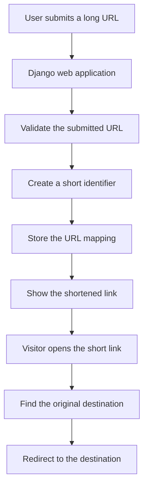

<div align="center">

# URL Shortener

### Turn Long URLs into Short, Shareable Links

A Django-based Python project focused on URL shortening, short-link routing, and redirect handling.

<p>
  
  
  
  
</p>

[Repository](https://github.com/maahii-in/url_shortner_python) · [Issues](https://github.com/maahii-in/url_shortner_python/issues)

</div>

---

## About the Project

**URL Shortener** is a Python web-project built around Django and the idea of converting long web addresses into shorter, easier-to-share links. A typical URL shortener stores a relationship between a short identifier and its destination URL, then redirects visitors to that destination when they open the short link.

The repository contains Django command-line and deployment configuration, a Python dependency list, a runtime specification, and an SQLite database file. The project is a starting point for exploring Django routing, database-backed web applications, and deployment with Gunicorn.

> **Repository status:** The current GitHub file list does not include the `urlshortner/` Django project package. However, `manage.py` references `urlshortner.settings` and the `Procfile` references `urlshortner.wsgi:application`. A fresh clone will not run until the missing Django source package is restored.

## Intended User Flow



This diagram describes the standard URL-shortening flow. The exact implementation and available user-facing features must be confirmed after the Django source files are restored.

## Technology Stack

| Technology | Role in the project |
|---|---|
| Python 3.9.1 | Runtime version specified in `runtime.txt` |
| Django 3.1.4 | Web framework pinned in `requirements.txt` |
| Gunicorn | WSGI server referenced by the `Procfile` |
| WhiteNoise | Static-file support dependency |
| Hashids | Identifier-related dependency included in the requirements |
| ShortUUID | URL-friendly identifier utility included in the requirements |
| SQLite | A `db.sqlite3` file is present in the repository |
| Git and GitHub | Source control and project hosting |

Package inclusion does not by itself confirm that every dependency is used by the application at runtime. See `requirements.txt` for the pinned dependency list.

## Repository Contents

The current repository contains these root-level files:

```text
url_shortner_python/
├── Procfile
├── README.md
├── db.sqlite3
├── manage.py
├── requirements.txt
└── runtime.txt
```

### File Reference

| File | Description |
|---|---|
| `manage.py` | Django command-line entry point; expects `urlshortner.settings` |
| `requirements.txt` | Pinned Python dependencies |
| `runtime.txt` | Specifies `python-3.9.1` |
| `Procfile` | Starts Gunicorn using `urlshortner.wsgi:application` |
| `db.sqlite3` | SQLite database file committed to the repository; inspect before sharing or deployment |
| `README.md` | Project documentation |

### Django Source Package Needed

The following package is referenced by the configuration files but is not present in the current root-level repository listing:

```text
urlshortner/
├── __init__.py
├── settings.py
├── urls.py
├── wsgi.py
└── asgi.py
```

Restore the actual project package and any Django application modules from your source or backup. The tree above shows the expected configuration-file names, not files that currently exist in the repository.

## Getting Started

### Prerequisites

- Git
- Python 3.9.x, matching the repository's `runtime.txt` as closely as possible
- pip
- A terminal or command-line interface

The pinned dependencies are old. Installation may fail on newer operating systems or Python versions, and upgrading packages may require compatibility changes. Start with the repository's declared versions before changing them.

### 1. Clone the Repository

```bash
git clone https://github.com/maahii-in/url_shortner_python.git
cd url_shortner_python
```

### 2. Create a Virtual Environment

**Linux / macOS**

```bash
python3.9 -m venv .venv
source .venv/bin/activate
```

**Windows PowerShell**

```powershell
py -3.9 -m venv .venv
.venv\Scripts\Activate.ps1
```

### 3. Install Dependencies

```bash
python -m pip install --upgrade pip
python -m pip install -r requirements.txt
```

If a package fails to install, check the error output, Python version, operating-system compatibility, and the package's build requirements before changing pinned versions.

### 4. Restore the Django Source Files

Before running Django commands, ensure the repository contains the `urlshortner/` package and its referenced configuration modules. The current public repository does not include them, so the commands below cannot succeed from a fresh clone until those files are restored.

### 5. Apply Database Migrations

Once the source package has been restored and configured:

```bash
python manage.py migrate
```

### 6. Start the Development Server

```bash
python manage.py runserver
```

Then open:

[http://127.0.0.1:8000/](http://127.0.0.1:8000/)

Available routes and pages depend on the restored Django URL configuration.

## Deployment

The repository's `Procfile` contains this command:

```text
web gunicorn urlshortner.wsgi:application --log-file -
```

This tells a compatible hosting platform to start the Django WSGI application through Gunicorn. Deployment will require the referenced `urlshortner.wsgi` module to exist and the Django settings to be configured for the target environment.

Before deploying:

- Restore and test the Django source package.
- Keep the Django secret key in environment variables or a secrets manager.
- Set `DEBUG=False` in production.
- Configure `ALLOWED_HOSTS` for the deployment domains.
- Configure the intended database and persistent storage.
- Configure static-file collection and serving.
- Apply database migrations during deployment.
- Use HTTPS and secure cookie/session settings.
- Test the production configuration before exposing the service publicly.

A `Procfile` is deployment configuration; it does not mean a working live deployment is currently available.

## Security Considerations

A URL shortener accepts user-provided destinations, so the application should handle links and stored data carefully.

- Validate URL formats and allow only appropriate schemes, normally `http` and `https`.
- Consider protections against malicious destinations and abusive link creation.
- Keep secret keys, passwords, and other credentials out of source control.
- Do not expose the Django debug page in production.
- Configure allowed hosts, secure cookies, CSRF protection, and HTTPS appropriately.
- Review `db.sqlite3` before committing or sharing it to ensure it contains no private or sensitive user data.
- Keep dependencies maintained, reviewing compatibility before upgrades.
- Consider rate limiting and abuse reporting for a public-facing service.

## Roadmap

Potential improvements for a more complete and maintainable URL-shortening service:

- [ ] Restore and document all Django project and application modules.
- [ ] Add a reproducible, tested setup with compatible dependencies.
- [ ] Validate and normalize submitted URLs.
- [ ] Improve the user interface and mobile responsiveness.
- [ ] Add automated tests for URL creation and redirection.
- [ ] Add custom aliases or link expiration if appropriate.
- [ ] Add optional click analytics and link-management features.
- [ ] Move configuration to environment variables.
- [ ] Add CI checks for tests and code quality.
- [ ] Document a verified deployment process.

These are proposed enhancements, not claims about features available in the current repository.

## Contributing

Contributions that improve correctness, maintainability, security, tests, and documentation are welcome.

1. Fork the repository.
2. Create a branch for your change.
3. Make a focused update and test it.
4. Commit with a descriptive message.
5. Open a pull request explaining the change and validation performed.

Please do not commit credentials, private database contents, or files that you do not have permission to redistribute.

## License

No `LICENSE` file is currently listed in the repository. Until a license is added, do not assume that the project is available for unrestricted redistribution or reuse. Add a license file to make the intended permissions clear.

## Author

**Maahi-in**

- GitHub: [@maahii-in](https://github.com/maahii-in)
- Repository: [url_shortner_python](https://github.com/maahii-in/url_shortner_python)

---

<div align="center">

**Python · Django · Web Development**

<sub>Build clearly. Share simply. Develop responsibly.</sub>

</div>
